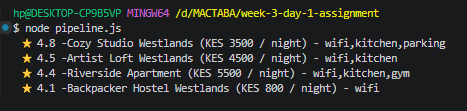
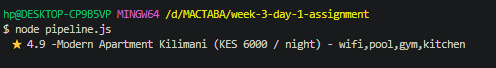
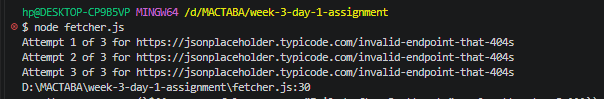

//function to find the top listing that uses chained array methods

findTopListings(listings, "Westlands", 5000);
output   >>>    

findTopListings(listings, "Kilimani", 10000)
output >>>    

//sample output for function resilientFetch(url)
>>>>